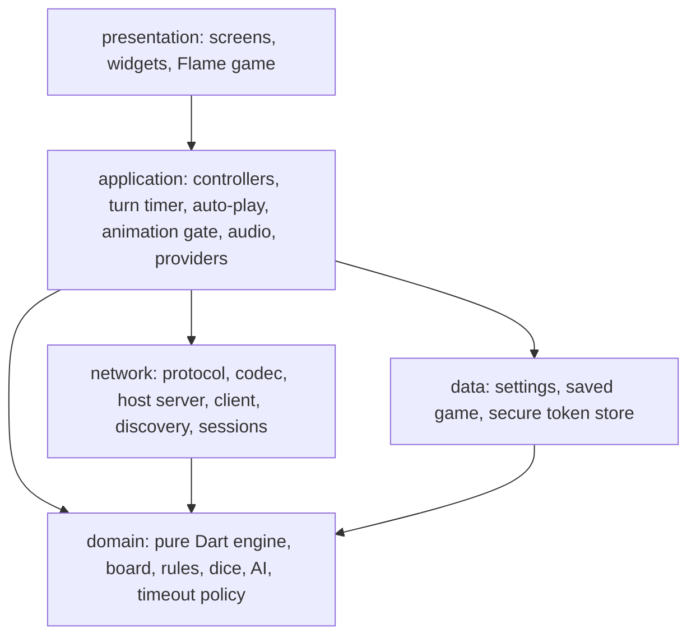
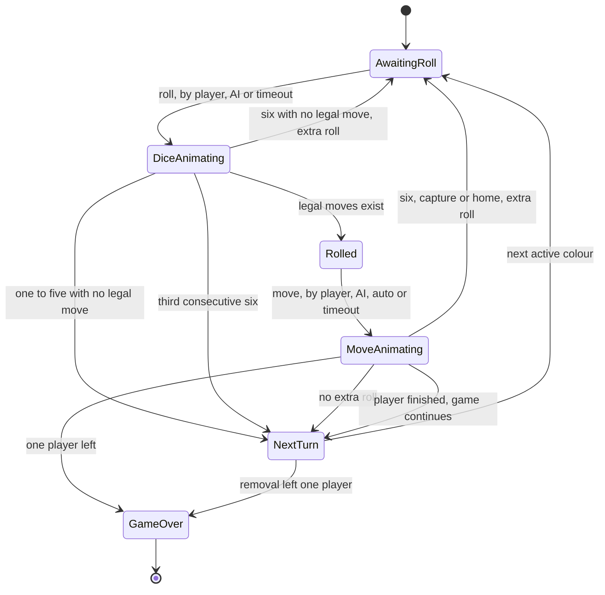
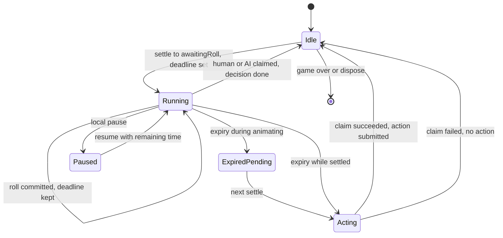
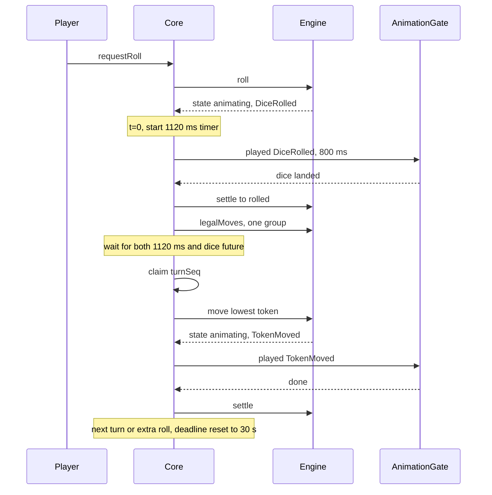
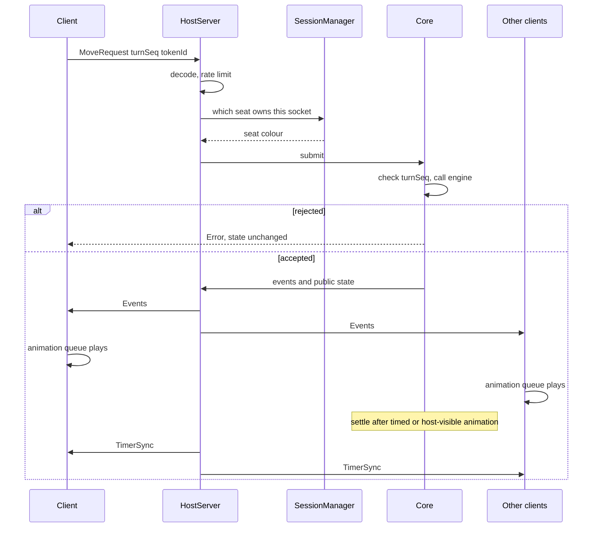
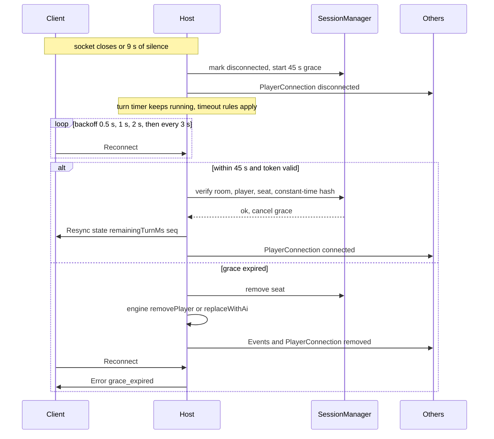

# Architecture

This document turns the product spec into a buildable design. `docs/AUDIT.md` records the starting point, `docs/PROTOCOL.md` defines the network messages, and `docs/DECISIONS.md` logs each decision.

Section numbers such as §1.3 refer to the build spec.

## 1. Stack

Versions below were resolved together against Flutter 3.41.6 and Dart 3.11.4.

| Concern | Package |
|---|---|
| Board, tokens, in-board effects | `flame` 1.38, `flame_riverpod` 5.5 |
| State | `flutter_riverpod` 3.3, hand-written providers |
| Models and messages | `freezed` 3.2, `json_serializable` 6.14 |
| Navigation | `go_router` 17.5 |
| Discovery | `nsd` 5.0, plus a `dart:io` UDP fallback on Android |
| Local IP labels | `network_info_plus` 8.2, with `NetworkInterface.list()` as the source of addresses |
| QR | `mobile_scanner` 7.5, `qr_flutter` 4.1 |
| Storage | `shared_preferences` 2.5, `flutter_secure_storage` 11.2 |
| Audio | `flame_audio` 2.12 |
| Crypto and async helpers | `crypto` 3.0, `async` 2.13 |
| Lints | `very_good_analysis` 10.2 |
| Tests | `flutter_test`, `fake_async`, `mocktail` |

Two choices differ from the obvious one:

- **Host addresses come from `NetworkInterface.list()`.** `network_info_plus` reports the Wi-Fi client address, which is absent on a device that is itself the hotspot.
- **Keep-awake is a small native method channel** (`FLAG_KEEP_SCREEN_ON` on Android, `isIdleTimerDisabled` on iOS). `wakelock_plus` cannot resolve alongside `network_info_plus` on this SDK.

## 2. Layers

Dependencies point downward only.



The spec's folder layout (§3.3) is feature-first, so each folder maps onto a layer:

| Layer | Folders |
|---|---|
| domain | `features/game/{models,engine,rules}`, `features/game/services/{dice_service,secure_dice_service,scripted_dice_service}.dart`, `features/ai/`, `core/constants/` |
| application | `features/game/{controllers,providers}`, `features/game/services/{turn_timer,auto_play,audio_service}.dart`, `features/lobby/lobby_controller.dart`, `features/multiplayer/{host,client}_game_controller.dart` |
| network | `core/networking/`, `features/multiplayer/protocol/`, `features/multiplayer/session_manager.dart` |
| data | `features/settings/data/`, `features/game/data/` |
| presentation | `app/`, `features/game/{flame,widgets,screens}`, all `*_screen.dart` |

Because folders alone cannot enforce this, `test/architecture/layering_test.dart` parses imports and fails if:

- a domain file imports Flutter, Flame, Riverpod or `dart:io`;
- a network or data file imports `features/**/{flame,widgets,screens}`;
- a domain file imports any other layer.

The folder structure is otherwise §3.3 unchanged, with these additions: `features/game/data/`, `features/settings/data/`, `features/game/services/animation_gate.dart`, and `test/architecture/`.

## 3. Domain model

All models are immutable `freezed` classes with value equality and `toJson`.

- `PlayerColor { red, blue, yellow, green }` with `startIndex` 0/13/26/39 and clockwise order.
- `Token { id (0..3), color, rel (-1..56) }`.
- `Player { id, color, name, kind (human|ai|remote), aiLevel?, connection (connected|disconnected|removed), finishedRank?, stats }`.
- `PlayerStats { tokensHome, captures, timesCaptured, sixes }`.
- `Move { tokenId, fromRel, toRel, captures, entersBase, reachesHome }`.
- `GameEvent` is the sealed set from §3.4.

`GameState` holds the §3.4 fields, plus one addition:

| Field | Meaning |
|---|---|
| `phase` | `awaitingRoll`, `rolled`, `animating`, `gameOver` |
| `nextPhase` | *Added.* The phase to enter when the current animation settles. Non-null only while `animating`. |
| `dice` | Last committed roll for the current decision, or null |
| `sixesThisTurn` | Consecutive 6s in this turn |
| `turnSeq` | Decision-point counter; see below |
| `turnDeadline` | Host-clock deadline in milliseconds. Written only by controllers, excluded from equality and from the state hash. Never sent over the network. |
| `ranking` | Finishers in order |
| `leavers` | *Added.* Removed colours, in order of leaving |
| `eventSeq` | Count of events emitted so far |

**`turnSeq` counts decision points, not turns.** It increments on every committed roll, move, pass and removal of the current player. This gives one identity for "the decision the game is waiting on", so a stale tap, a stale timer callback and a stale network intent are all rejected by the same comparison.

**`animating` lives in the state, and the engine enforces it.** `roll` and `move` commit their result and return `phase: animating` with `nextPhase` set. `settle` moves to `nextPhase`. Any roll or move during `animating` is rejected by the engine itself, so "input is disabled during animation" holds for taps, AI, timers and network intents without separate checks in each.

## 4. Engine contract

```dart
typedef Commit = (GameState, List<GameEvent>);

abstract final class GameEngine {
  static Result<Commit, RuleError> roll(GameState s, PlayerId p, DiceService dice);
  static Result<Commit, RuleError> move(GameState s, PlayerId p, int tokenId);
  static GameState settle(GameState s);
  static Result<Commit, RuleError> passForTimeout(GameState s);
  static Result<Commit, RuleError> removePlayer(GameState s, PlayerId p);
  static Result<Commit, RuleError> replaceWithAi(GameState s, PlayerId p, AiLevel level);
}

List<Move> legalMoves(GameState s);
Move timeoutMove(GameState s);
List<List<Move>> equivalentMoveGroups(List<Move> moves);
```

- Pure and deterministic given the dice service. No clock, no I/O.
- A rejected call returns a `RuleError` and the caller keeps the identical state instance.
- `legalMoves` is the only place legality is decided. UI highlights, AI, auto-play, timeout policy and validation all call it.
- `legalMoves` reads `dice` while `phase` is `rolled`, or while `animating` with `nextPhase == rolled`, so a controller can schedule auto-play during the dice animation.
- `equivalentMoveGroups` groups moves by `fromRel`. One group means one effective choice, and the lowest token index moves.

Roll outcomes, in the order they are evaluated:

1. A third consecutive 6 emits `ThreeSixesForfeit` and passes the turn. Earlier moves stand.
2. Otherwise, `sixesThisTurn` becomes `+1` on a 6 and `0` on any other face.
3. Legal moves exist: `nextPhase = rolled`.
4. No legal moves on a 6: `ExtraRoll(six)`, `nextPhase = awaitingRoll`, same player.
5. No legal moves on 1–5: `TurnPassed(noMoves)`, next player.

Move outcomes:

1. Apply the move and capture every opponent token on the destination if it is an unsafe main-track cell.
2. If all four tokens are home, emit `PlayerFinished` and pass the turn, dropping any extra roll.
3. If only one player remains unfinished, rank them, then rank leavers below them, and emit `GameOver`.
4. Otherwise a 6, a capture or reaching home grants exactly one extra roll.
5. Otherwise pass to the next seated colour clockwise that is neither finished nor removed.

Dice services are `SecureDiceService`, `ScriptedDiceService` (throws when exhausted) and `SeededDiceService`.

## 5. Turn state machine



`DiceAnimating` and `MoveAnimating` are both `phase: animating`, distinguished by `nextPhase`.

## 6. Controllers

All three controllers implement one interface, and the UI depends only on that:

```dart
abstract class GameController {
  ValueListenable<GameState> get state;
  ValueListenable<int> get remainingTurnMs;
  Stream<GameEvent> get events;
  Set<PlayerColor> get controlledColors;
  Future<void> requestRoll();
  Future<void> requestMove(int tokenId);
  void bindAnimationGate(AnimationGate gate);
  Future<void> dispose();
}
```

| Controller | Owns engine | Behaviour |
|---|---|---|
| `LocalGameController` | Yes | Pass-and-play and AI seats. Saves after every settle. |
| `HostGameController` | Yes | As local, plus sessions, broadcast, intent validation, grace timers. |
| `ClientGameController` | No | Sends intents, mirrors host state, plays host events. Runs no rules and no auto-actions. |

`LocalGameController` and `HostGameController` share `AuthoritativeGameCore`, so turn logic is written once. Every command, whether from a tap, AI, timer or socket, passes through `core.submit`, which:

1. Checks that `turnSeq` matches and the game is not over.
2. Calls the engine.
3. On success, claims the decision, publishes state and events, and schedules the settle.

### Animation gate

`AnimationGate` is how the core waits for what the player sees:

```dart
abstract class AnimationGate {
  Future<void> played(List<GameEvent> events);
}
```

| Implementation | Used by | Completes when |
|---|---|---|
| `FlameAnimationGate` | Device with a visible board | The animation queue finishes those events |
| `TimedAnimationGate` | Headless or backgrounded host | The fixed budget elapses |
| Test fakes | Tests | The test completes the future |

Flame stops ticking when the app is backgrounded, so a gate waiting on effects would stall the game for everyone. On `AppLifecycleState.paused`, the core switches to `TimedAnimationGate` and the queue drains without animating. An in-flight future is completed at the switch.

### Timing rules

| Constant (`core/constants/timing.dart`) | Value |
|---|---|
| Turn timer | 30 s |
| Dice animation | 800 ms, fixed |
| Auto single-move | 1120 ms from roll commit, and not before the dice future completes |
| Token hop | 150 ms per step at 1× |
| Capture return | 600 ms |
| AI think delay | 600–900 ms |
| Reconnect grace | 45 s |
| Heartbeat interval and timeout | 3 s and 9 s |

- The 30 s deadline is set when a settle lands in `awaitingRoll` for a new turn or an extra roll. It continues unchanged through the roll into choosing a move.
- A timer that expires during `animating` is recorded and acted on at the next settle, so it cannot interrupt an animation.
- **Online games ignore the animation speed setting and always run at 1×.** The host's timed budget must match what every client plays. The setting applies to local games.
- Reduce-motion replaces arcs, shakes and particles with simple transitions and keeps the same durations, so game timing does not vary by device.

### Exactly one automatic action per decision

`DecisionGuard` holds the last claimed `turnSeq`:

- `claim(turnSeq)` returns true once per decision. Human commands, AI, auto-move and timer expiry all claim before submitting.
- Each pending auto-action is a single `CancelableOperation`.
- Every timer callback checks `turnSeq` and `!gameOver` before doing anything.
- Timers are cancelled on turn change, local pause, game over and dispose.
- All timers use the injected `Clock`, so `fake_async` drives them in tests.



Pausing applies to local games only. In online games, the Pause screen is an overlay and the timer keeps running, because one player must not be able to stop the game for everyone.

### Local turn with auto-move



If legal moves form several groups, the core waits for a tap, the AI, or expiry. On expiry it plays `timeoutMove`.

## 7. AI

`AiPlayer.choose(state, level, weights, random)` returns a token id. The core then submits it like any other command, after the think delay. If a roll leaves one effective choice, auto-play handles it and the AI does not act.

Scoring is the §1.6 list, with every weight in `AiWeights`. Easy picks randomly among the top 3 using an injected `Random`, and Normal picks the best with the lowest token index on a tie.

## 8. Online multiplayer

### Host and client turn



Clients render the state carried in `Events` only after their queue has played those events, so tokens never jump ahead of their animation. If the queue falls more than one batch behind, the client plays the backlog at high speed until it catches up.

### Disconnect, reconnect, removal



A `Reconnect` can arrive before the host notices the old socket died. In that case the seat is still `connected`, and after authentication the host closes the old socket and binds the new one.

After a `Resync`, the client discards its animation queue and jumps to the received state.

### Sessions and secrets

- `SessionManager` is the only class holding reconnect data. It stores `playerId → (sha256(token), socket, graceTimer)`, and the plaintext token exists only long enough to send `Welcome`.
- `PublicGameStateSerializer` takes a `GameState` and has no reference to `SessionManager`. `GameState` has no field that could hold a secret.
- The logger accepts typed log records. `Welcome` and `Reconnect` are logged by type only.
- Client tokens live in `flutter_secure_storage` and are cleared on game over or leave.

### Discovery and addresses

| Method | Android | iOS |
|---|---|---|
| Bonjour `_ludo._tcp` | Yes | Yes |
| UDP broadcast, port 47820 | Yes | No (restricted entitlement) |
| QR `ludo://host:port/ROOM` | Yes | Yes |
| Manual address | Yes | Yes |

`AddressParser.parse(String)` returns `Result<HostAddress, AddressError>` and never throws. It accepts the §1.5 formats.

At connect time, the resolved IP must be private (RFC 1918, link-local or loopback). `network_security_config.xml` matches domain names and cannot express IP ranges, so app code enforces this rule.

The first connection on iOS triggers the Local Network permission prompt and can fail until it is accepted. The client's retry loop covers that case.

### App lifecycle

| Event | Host | Client |
|---|---|---|
| Screen timeout during a game | Prevented by keep-awake | Prevented by keep-awake |
| App backgrounded | The OS may suspend the server. A warning is shown on the host screen before starting. Clients see "Host lost" if it stops responding. | Socket drops, and the client reconnects on resume within the 45 s grace |

## 9. Flame board

- One `LudoGame extends FlameGame with RiverpodGameMixin`.
- A `CameraComponent` with `visibleGameSize` of 15×15 and a top-left anchor, so one world unit is one cell. Resize needs no layout recalculation.
- The static board is rendered once to a `ui.Image` and redrawn only when the palette or the size changes, which keeps frame cost flat.
- `TokenComponent` position comes from a pure `cellCentre(row, col)` plus a stack offset.
- A hop is a `MoveToEffect` per cell along the event's absolute path, with a `ScaleEffect` arc and a shadow. Diagonal corner steps follow the same path.
- `AnimationQueue` plays events in order, and completes each future from the effect's `onComplete`. Removing a component also completes its pending futures.
- Highlights and ghosts come from `legalMoves`. A tap calls `controller.requestMove` and never moves a component directly.
- `LudoGame.palette` is set from the widget's `didChangeDependencies`. Components read it at render, so theme changes apply live.

## 10. Presentation

Routes (`go_router`): `/`, `/home`, `/local-setup`, `/host`, `/join`, `/game`, `/results`, `/settings`, `/how-to-play`. Pause and connection dialogs are overlays on `/game`.

Game layout, portrait:

```
[ Blue card ] [ Yellow card ]
[      Board (square)       ]
[ Red card  ] [ Green card  ]
[        Status line        ]
```

- Each card sits next to its yard.
- `boardSide = min(width - 2 * margin, height - cardRows - statusLine - safeArea)`.
- Cards have fixed dimensions from `CardMetrics.forWidth(width)`. The active state changes only colour, glow and ring.

Colours come only from the `AppColors` and `BoardPalette` theme extensions.

## 11. Persistence

| Data | Store | Notes |
|---|---|---|
| Appearance, sound, music, haptics, animation speed, name, default AI, last host | `shared_preferences` | |
| Saved local game | `shared_preferences` | `{schemaVersion, state, remainingTurnMs}`, written at each settle. A rolled dice is saved, so restarting cannot re-roll it. |
| Reconnect session | `flutter_secure_storage` | Room, player id, token, host address |

## 12. Test strategy

The §6.7 list is the required set, with these placement rules:

| Folder | Covers |
|---|---|
| `test/domain/` | Board, engine, capturing, ranking, AI, dice fairness |
| `test/application/` | Timers, auto-play, guards, save and resume |
| `test/network/` | Codec, sessions, secrets, address parser, loopback game |
| `test/widget/` | Screens, overflow, card size, audio mute, contrast, manifest |
| `test/goldens/` | 18 goldens: 3 screens, 2 modes, 3 sizes |
| `test/architecture/` | Layering |

`SecureDiceService` cannot be seeded, so its χ² check has a 0.1% false-failure rate by design. If it trips, the printed counts decide whether it was chance. The threshold is not loosened.
